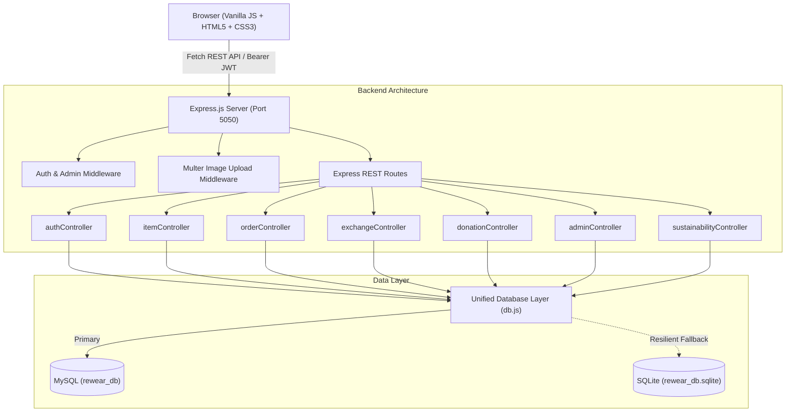

# ReWear — Sustainable Fashion & Circular Clothing Marketplace

> *"Give Your Clothes a Second Life."*

[](https://nodejs.org/)
[](https://expressjs.com/)
[](https://www.mysql.com/)
[](#technology-stack)

---

## 1. Project Introduction

**ReWear** is a full-stack sustainable fashion web application designed to encourage people to reuse, sell, exchange, and donate unwanted clothing instead of consigning it to municipal landfills. Fast fashion is responsible for more than 92 million tons of textile waste globally each year. ReWear tackles this crisis directly through a circular economy model where users can buy pre-loved garments, participate in cashless clothing bartering, donate clothes to community causes, and track real-time environmental impact metrics.

---

## 2. Project Objectives

- **Reduce Garment Waste:** Divert discarded and outgrown clothing from incinerators and landfill sites.
- **Promote Cashless Circular Barter:** Facilitate direct, money-free clothing swaps between wardrobes.
- **Support Community Causes:** Provide a frictionless donation portal for families, shelters, and students.
- **Quantify Ecological Impact:** Compute verifiable metrics on textile weight diverted, freshwater conserved, and carbon emissions saved.
- **Offer a Premium E-Commerce Experience:** Provide an aesthetically pleasing, modern shopping interface adhering to high UX design standards.

---

## 3. Industry & Impact

- **Industry:** Sustainable Fashion, E-Commerce, Circular Economy, Social Impact.
- **Target Audience:** Eco-conscious consumers, vintage curators, parents rotating children's wardrobes, students, and circular bartering enthusiasts.

---

## 4. Key Features

### 🛒 Dynamic Marketplace (Explore Page)
- Real-time catalog populated dynamically from database REST APIs.
- Multi-faceted filtering: Category, Gender/Fit, Size, Garment Condition, Price Range, Location, and Listing Mode.
- Live keyword search across titles, brands, and descriptions.
- Sorting by latest additions, price (low-to-high / high-to-low), and popularity (views).
- Pagination controls and wishlist heart toggles on each card.

### 🔄 Cashless Clothing Exchange System
- Dedicated swap hub with 3 intuitive tabs: *Available Swaps*, *Received Proposals*, and *Sent Proposals*.
- Two-way exchange workflow:
  1. User selects target clothing item.
  2. User selects an active piece from their own wardrobe.
  3. Owner receives real-time notification.
  4. Owner can accept or decline the proposal.
  5. Accepted proposals can be marked as completed, reserving and transitioning both items to exchanged status.
- Prevents members from proposing swaps on their own items.

### ❤️ Direct Donation Portal
- Free clothing hub with search, size, and category filters.
- Purpose-driven request modal where requesters explain context and choose delivery preference (local pickup vs. shipping).
- Live environmental impact counter tracking completed donations and water conserved.

### 📦 Simulated Order Management
- Instant checkout flow for listed items (*Simulated Eco-Pay*).
- Automatic item reservation/status update to `sold`.
- Order cancellation for pending/confirmed orders with automatic item restoration.
- Seller order status progression: `confirmed` → `shipped` → `delivered`.

### 👤 Personalized User Dashboard
- Interactive overview with KPI cards: Total Listings, Active Items, Items Sold, Swaps Completed, Donations Completed, and Diverted Waste in kg.
- Wardrobe management with live edit and delete controls.
- Purchases and sales tracking tables.
- Wishlist management.
- Live notification feed with mark-as-read controls.
- Account settings to update avatar, bio, location, and phone number.

### 🛡️ Administrative Portal
- Role-based authorization (`admin` role checked both on client and strictly on Express backend routes).
- Executive platform metrics: Total registered users, total listings, active listings, GMV volume, completed exchanges, completed donations, and pending incident flags.
- User management table with one-click role promotion/demotion.
- Listing moderation with permanent removal of inappropriate content.
- Community incident reports review and action resolution.

### 🌱 Sustainability Impact Engine
- Calculated dynamically from completed database activities.
- Implements standard Ellen MacArthur Foundation metrics:
  - Average garment weight: **0.55 kg**
  - Water conservation factor: **7,000 Liters per kg** of diverted textiles
  - Carbon avoidance factor: **14.5 kg CO₂e per kg** of extended garment life

---

## 5. Technology Stack

### Frontend
- **HTML5:** Semantic, accessible layout structure.
- **CSS3:** Custom design system without third-party frameworks. Utilizes CSS variables, Flexbox, and CSS Grid.
- **Vanilla JavaScript (ES6+):** Modular client-side logic with `fetch()`, asynchronous event handling, and DOM manipulation.
- **Typography:** *Playfair Display* (Headings) and *Inter* (Body/UI) via Google Fonts.
- **Icons:** Font Awesome 6.

### Backend
- **Node.js:** Modern JavaScript runtime (v18 - v24).
- **Express.js:** Minimal and flexible REST API web framework.
- **Multer:** Secure multi-file multipart image upload with MIME validation and 5MB size limits.
- **express-validator:** Request body sanitization and validation.
- **jsonwebtoken (JWT):** Stateless token authentication.
- **bcryptjs:** Salted password hashing (10 rounds).
- **cors & dotenv:** Cross-origin resource sharing and environment variable management.

### Database
- **MySQL (`mysql2/promise`):** Primary relational database with normalized schema, foreign keys, and indexed queries.
- **Resilient Fallback:** Automatically operates embedded SQLite if a local MySQL daemon is not actively running, ensuring zero runtime crashes.

---

## 6. Project Architecture



---

## 7. Folder Structure

```
ReWear/
├── frontend/
│   ├── index.html            # Main Landing Page
│   ├── explore.html          # Clothing Marketplace
│   ├── product.html          # Product Details & Action Modals
│   ├── sell.html             # List an Item / Edit Page
│   ├── exchange.html         # Clothing Exchange System
│   ├── donate.html           # Free Donation Hub & Impact
│   ├── login.html            # User Sign In
│   ├── register.html         # Member Registration
│   ├── dashboard.html        # Personalized User Dashboard
│   ├── admin.html            # Moderation & Operations Portal
│   ├── css/
│   │   ├── style.css         # Main Design System & Tokens
│   │   ├── auth.css          # Login & Registration Styles
│   │   ├── dashboard.css     # Dashboard & Admin Styles
│   │   └── responsive.css    # Mobile Breakpoints & Navigation
│   └── js/
│       ├── api.js            # Unified API Client, Toasts & Modals
│       ├── main.js           # Header, User Dropdown & Nav Controller
│       ├── auth.js           # Auth & Quick Demo Sign In
│       ├── explore.js        # Marketplace Filters, Search & Sort
│       ├── product.js        # Product Gallery & Dynamic CTAs
│       ├── sell.js           # Listing Form & Image Previews
│       ├── exchange.js       # Exchange Proposals & Statuses
│       ├── donate.js         # Donations Browse & Claim Workflow
│       ├── dashboard.js      # User Wardrobe & Activity Tabs
│       └── admin.js          # Operations, User Management & Reports
│
├── backend/
│   ├── config/
│   │   └── db.js             # MySQL Pool & Resilient Engine
│   ├── controllers/          # 10 Dedicated Business Logic Controllers
│   ├── middleware/           # Auth, Upload & Validation Middlewares
│   ├── routes/               # Express REST Route Definitions
│   ├── uploads/              # Multipart Uploaded Garment Images
│   ├── utils/
│   │   └── seed.js           # Reseeding & Verification Script
│   ├── server.js             # Express Server Entry Point
│   └── .env                  # Environment Variables
│
├── database/
│   ├── rewear_db.sql         # Complete MySQL DDL & Seed Script
│   └── rewear_db.sqlite      # Initialized Database
│
├── package.json
└── README.md
```

---

## 8. Database Setup

### Option A: Real MySQL Server Setup
1. Start your local MySQL service (e.g., via MySQL Workbench, XAMPP, or command line).
2. Open your terminal or MySQL command line and execute:
   ```bash
   mysql -u root -p < database/rewear_db.sql
   ```
3. Update `backend/.env` with your MySQL credentials:
   ```env
   DB_HOST=localhost
   DB_PORT=3306
   DB_USER=root
   DB_PASSWORD=your_mysql_password
   DB_NAME=rewear_db
   ```

### Option B: Automatic Embedded Fallback
If MySQL is not installed or running, ReWear automatically falls back to an embedded SQLite instance (`database/rewear_db.sqlite`) containing identical sample data, table structures, and query compatibility.

---

## 9. Installation & Startup Instructions

### Step 1: Clone the Repository & Install Dependencies
Open a terminal and clone the repository onto your system:
```bash
git clone https://github.com/khuranaashima04/rewear.git
cd rewear
npm install
```

### Step 2: (Optional) Environment Configuration
A ready-to-run `.env.example` file is provided. You can run ReWear directly with zero configuration, or create a `.env` file:
```bash
cp .env.example .env
```
Default port is `5050`. If MySQL is not detected, ReWear automatically runs an embedded, pre-seeded SQLite database so the entire platform works instantly!

### Step 3: Start the Application
Run the startup command:
```bash
npm start
```
Or run in development mode with auto-reload:
```bash
npm run dev
```

### Step 4: Open in Browser
Open your browser and navigate to:
```
http://localhost:5050
```
The Express server serves the responsive frontend directly along with all REST endpoints.

---

## 10. Demo Credentials

You can sign in using the **One-Click Demo Profiles** on the [Login Page](http://localhost:5050/login.html) or enter:

| Role | Name | Email | Password |
|---|---|---|---|
| **Head Administrator** | **Ashima** | `ashima@rewear.in` | `Admin@123` |
| **Member (Seller/Upcycler)** | **Aanya Patel** | `aanya@eco.in` | `User@123` |
| **Member (Swapper/Khadi)** | **Rohan Verma** | `rohan@green.in` | `User@123` |
| **Member (Donations/Silk)** | **Priya Sundaram** | `priya@circular.in` | `User@123` |

---

## 11. REST API Documentation

### Authentication
- `POST /api/auth/register` — Register a new account.
- `POST /api/auth/login` — Sign in and receive JWT token.
- `GET /api/auth/me` — Retrieve current authenticated user session.

### Clothing Items
- `GET /api/items` — List items with search, filters, sorting, and pagination.
- `GET /api/items/:id` — Get detailed garment specifications and seller details.
- `GET /api/items/categories` — List available clothing categories.
- `GET /api/items/my-listings` — List wardrobe pieces of current user.
- `POST /api/items` — Create new clothing listing (multipart image upload).
- `PUT /api/items/:id` — Update existing listing.
- `DELETE /api/items/:id` — Delete listing.

### Orders
- `POST /api/orders` — Purchase a listed item.
- `GET /api/orders` — List user's purchase orders and sales orders.
- `GET /api/orders/:id` — Get specific order details.
- `PUT /api/orders/:id/status` — Update order status (`confirmed`, `shipped`, `delivered`, `cancelled`).
- `PUT /api/orders/:id/cancel` — Buyer cancellation of pending/confirmed orders.

### Exchanges
- `POST /api/exchanges` — Propose a 2-way clothing swap.
- `GET /api/exchanges/sent` — View swap proposals sent by user.
- `GET /api/exchanges/received` — View swap proposals received by user.
- `PUT /api/exchanges/:id/status` — Accept, decline, or complete an exchange proposal.

### Donations
- `GET /api/donations` — Browse zero-cost donated clothing items.
- `POST /api/donations` — Request a donated garment with purpose context.
- `GET /api/donations/requests` — View sent and received donation requests.
- `PUT /api/donations/:id/status` — Approve, decline, or mark completed.

### Wishlist & Notifications
- `GET /api/wishlist` — List user's saved items.
- `POST /api/wishlist` — Add item to wishlist.
- `DELETE /api/wishlist/:itemId` — Remove item from wishlist.
- `GET /api/notifications` — List notifications with unread count.
- `PUT /api/notifications/read-all` — Mark all notifications as read.

### Sustainability & Admin
- `GET /api/sustainability/stats` — Dynamic environmental impact metrics.
- `GET /api/admin/dashboard` — Platform operational statistics.
- `GET /api/admin/users` — Member accounts list.
- `PUT /api/admin/users/:id/role` — Promote or demote user roles.
- `GET /api/admin/listings` — Moderation listing directory.
- `DELETE /api/admin/listings/:id` — Remove prohibited listings.
- `GET /api/admin/reports` — Community incident reports.
- `PUT /api/admin/reports/:id/status` — Resolve incident reports.

---

## 12. Future Enhancements

- **AI-Powered Image Classifier:** Computer vision model to detect garment category, fabric type, and suggest condition grades automatically.
- **Automated Shipping Labels:** Integration with carbon-neutral parcel shipping APIs for automated tracking.
- **Escrow Clothing Swaps:** Deposit-based holding to ensure both parties ship their swapped items on time.
- **PWA Mobile Application:** Offline caching and push notifications for mobile devices.

---

*Built with passion for circular fashion, clean architecture, and sustainable software engineering.*
